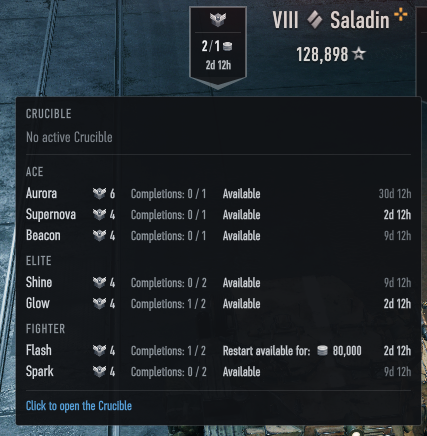
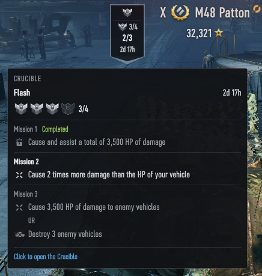
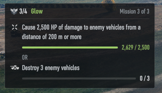

# Zanju's Crucible Tracker

### This mod shows the status of your Crucible missions in the garage, and their progress in battle.

- **One click to the Crucible** — click the banner to open the game's Crucible screen.
- **Warnings** — a battle icon and a count show your eligible vehicles that are still in a random battle. The result of an ongoing battle completes or fails the current mission if a Crucible is active when the battle ends.
- **Available Crucibles** — with no Crucible active, the banner counts the not yet completed Crucibles that end the soonest, and shows the time left. The count reads **free** / **credits** / **gold**: how many you can attempt for free, and how many restart for credits or for gold. When you complete all of them, the banner moves on to the Crucibles that end next. The tooltip lists every Crucible that is currently available.
- **Active Crucible** — the banner shows your remaining shields, the current mission and the time left. The tooltip shows all missions of the active Crucible, with their conditions.
- **Progress in battle** — a movable panel shows each condition of the current mission. Under a countable condition there is a progress bar with a numeric counter. A time limit such as "within the first 5 minutes of battle" counts down. Alternative conditions are shown after an "OR". The panel shows only when a Crucible is active and the vehicle is eligible for it.
- **Configurable** — in the game's settings window, you can turn the garage banner and the battle panel on or off. The battle panel can show the mission details always, only while you hold Alt, or never. Without them, each condition shows only its icon, bar and counter. You can also put the banner on the left or the right side of the vehicle name.

## Translations

Reference language `en` defines 24 strings, 8 of them in the [shared strings](../../mods-common/i18n/). Translations are community-maintained and may lag behind; see [Translating](../../docs/translating.md) to add or update one, then regenerate this table with `zwm lint i18n`.

| Language | Coverage | Missing |
| --- | --- | --- |
| `pl` | 100% (24/24) | 0 |
| `ru` | 17% (4/24) | 20 |
| `zh_cn` | 17% (4/24) | 20 |

## Install And Use

If you already have the prepared mod zip file, follow the general install path in [Installing Mods](../../docs/installing-mods.md).

## Build From Source

For the general build/toolchain workflow, see [Building From Source](../../docs/building-from-source.md).

## Develop

For the wider repository workflow, see:

- [Developing Mods](../../docs/developing-mods.md)
- [Architecture](../../docs/architecture.md)
- [Technical Reference](../../docs/reference/README.md)
